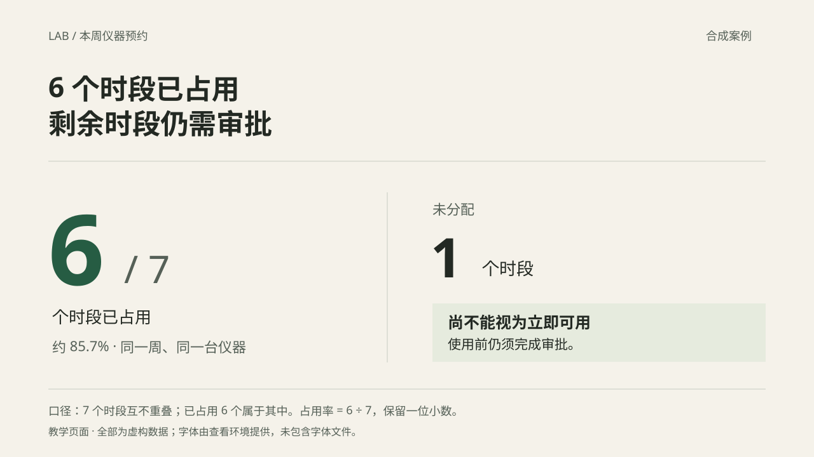

# 从材料到表达：教学案例

以下为虚构材料，不代表任何公司事实。每例保留材料、取舍、页面和检查点，学习决策过程，不照抄页数、配方或结论。独立评估换材料，避免只复现样例。SVG 是教学页面源文件；直接插入 PPTX 不会自动获得原生文本和图表的编辑能力。

## 1. 科研资源：数字更醒目，限制也必须看得见

**原材料**：“同一台仪器本周共有 7 个互不重叠的可预约时段，已占用 6 个，未分配 1 个；未分配的时段也须完成审批才能使用。”受众是需要判断资源余量的实验室负责人。

**提炼与选择**：已占用 6 个属于总数 7 个，范围和期间一致，因此可计算 6 ÷ 7 ≈ 85.7%。未分配差额为 1，不据此写“还有 1 个可立即使用”。重点是规模和条件，大数字加短句已足够，无须为了用图再画仪器或仪表盘。

**从材料稿到表达稿**：把原段落拆为标题、占用量、未分配量和限制。标题由笼统的“仪器预约情况”改为“6 个时段已占用，剩余时段仍需审批”；最醒目的是 6／7，右侧保留审批条件，公式与口径在页脚。没有删掉影响决策的内容。

**检查**：对照原文逐项核对 7、6、1、同一周、同一仪器、无重叠和审批条件；以实际页面大小看限制句，不让它退化成难读脚注。这里选择独立数字文本；若改为比例统计图，PPTX 仍须满足数据编辑要求。

**迁移边界**：如果 6 与 7 没有包含关系就不计算比例；22 个账户分成 7、10、5，只有分类互斥且完整时才是构成；10 个账户与 33 家企业未经映射不能算开户转化率。一个好看的百分比不能代替定义。

### 同类风险：实际、申请和预测

原材料：“计划接入 7 个站点，其中 6 个已上线；另申请 2 台网关；预计每月节约 30 小时，仍待验证。”

7 是计划总数，6 是完成数；2 是申请资源，30 是预测收益。确认 6 个属于计划 7 个、范围一致且无重复，可写“6／7 个计划站点已上线”。不能把网关画成已部署，或写“已节约 30 小时”。

表达：左侧完成进度，右侧待申请资源／待验证收益，文字明确状态。精简重复修饰，保留时间、范围与资源条件。若缺上线与计划对应关系，分别写 6 和 7，不计算比例。

## 2. 零售补货：把动作、条件和信息流画出来

原材料：“门店发起补货申请。规则引擎按库存阈值检查；通过后仓库备货，不通过返回门店补充信息。运营只接收周报。”

**提炼**：对象为门店、规则引擎、仓库、运营。关系为门店提交 → 规则校验；通过 → 仓库；不通过 → 门店补充；运营接收周报。原材料未指明周报由谁发送，不补造发送方。不能画成“门店—规则—仓库—运营”的单线审批，不能因岗位名就发明层级。

**从材料稿到表达稿**：主流程三节点，条件在箭头旁，退回补充有回路；运营接收周报单独说明，避免用审批箭头连接。HTML 用 SVG，需编辑的 PPTX 用原生节点、文字和连接线。实际页面见 [双格式样例](../examples/dual-format/README.md) 第 2 页。

**检查与修订**：原稿的回路转角若每段都带箭头，容易被误读成多个动作；样例修订为只在回到门店的末段显示箭头。逐条检查“谁做什么、什么条件成立、信息送给谁”。分组文字与移动经保存重开验证；移动后自动跟随如属合同，另做实机验证，线条存在不证明跟随正确。

## 3. 产品方案：比较成本时，把交付条件放在同一视线内

**原材料**：三个虚构方案，受众需要比较基础报价、预计交付和扩展条件。所有报价不含扩展费用，材料没有给定优先级或选择结论。

| 方案 | 基础报价 | 预计交付 | 扩展条件 |
|---|---|---|---|
| A | 6 万元 | 2 周 | 仅覆盖当前站点 |
| B | 8 万元 | 3 周 | 扩展需另配网关 |
| C | 11 万元 | 5 周 | 扩展需重新测算 |

**提炼与选择**：三个比较维度都必要，精确数值保留。共用的报价边界合为一条说明；不把预计交付改为保证，不把低报价解释为最低总成本。扩展条件是内容，不能缩成无意义的勾叉。

**从材料稿到表达稿**：保留横向比较关系，用共用行标签、三个等权方案区和共同条件栏构成矩阵，见 [双格式样例](../examples/dual-format/README.md) 第 3 页。数字突出，条件紧邻；没有为了视觉改变数据结构。如果原始大表另有非关键明细，应给明细安排可查位置，不能无声删除。

**检查与修订**：样例初稿把 B 的底色加重，视觉暗示了材料不存在的“推荐”。实际看图后改为等权背景。核对每一项数值、单位、预计状态和扩展条件；指定矩阵内 B 报价改字、分组移动并保存重开。这里用分组形状，是因为要求按格改字和移动；若要增删行列、粘贴整列则用原生表格。

这个例子保留矩阵，理由是任务仍然需要横向查数。趋势换成图、异常单独突出、共同项聚合，均由阅读任务触发，而非为变化而变形。

## 4. 培训须知：保留文字，比把条件串成流程更清楚

**原材料**：“面向已收到报名成功邮件的学员。7 月 12 日 13:30—14:00 本人凭报名二维码签到，14:00 活动开始；14:15 仍未签到将释放席位。不能参加请在 7 月 10 日 18:00 前取消；名额不可转让。候补由现场负责人按剩余席位安排，不保证入场。”

**提炼与选择**：受众要找到签到动作、两个不同日期的时间要求、本人使用限制与候补边界。它们不是人人都依次经历的流程；“取消”和“候补”是不同情形。用流程箭头会增加误解，保留分层文字。

**从材料稿到表达稿**：标题说明“已报名，仍需按时签到”；左栏按入场时间组织，右栏放取消与转让限制，底部留候补说明。删去重复的“学员／活动”措辞，不删除适用对象、二维码、日期、席位释放和不保证入场。

**检查**：读者应能分别回答“谁能用、何时签到、带什么、何时释放、如何取消、能否转让、候补是否有保证”。时间不能脱离日期；不要把“候补可能入场”提炼成“迟到仍可入场”。PPTX 用原生文本框与分隔线即可，不需要复杂图解。

## 图片按作用选择

- 真实设备／项目现场：用户照片或经核实、可用的真实来源，不生成“证据图”。
- 未来工作情境主视觉：专用生图工具可直接生成概念图，也可搜索；按风格、授权和质量选。
- 数据从终端流向服务：提取关系后用 SVG／原生图解，照片不能代替逻辑。
- 一句有力度的结论：排版可能足够，不为用图而用图。

放入实际版位后再检查裁切、清晰度、留白与含义，搜索缩略图和生成成功都不是验收。

## 从好样稿中学方法，不照抄风格

好样稿常见的几种优势，以及对应的做法：

| 观察到的优势 | 方法 | 证据 |
|---|---|---|
| 层级与排版完成度 | 先主信息和阅读顺序，再用尺度、对齐与间距组织 | 读图能顺着主张找到证据 |
| 覆盖与说明充分 | 梳理事实、状态、关系和条件，分配到页面／备注／附录 | 对照材料，关键条件仍可见 |
| 图形表达与变化 | 按任务选机制图、矩阵、图表或文字，不连续套卡片 | 图形对应内容关系，变化服务于讲述 |
| 实际交付能力 | 双格式分别渲染，按编辑需求测试具体对象 | 最终文件及测试副本有可复现结果 |

不能为了“大气”删证据，也不能为了“全面”挤满正文。保持共同设计语言，让各页用合适的表达解决不同问题。

## 可运行样例

[examples/dual-format](../examples/dual-format/README.md) 共享虚构数据生成 HTML 与原生 PPTX，展示长中文、分组机制图、形状矩阵、原生图表、图片与表格，输出具体编辑目标。它验证有限制作路径，不是通用转换引擎或全部公司模板的保真证明。
